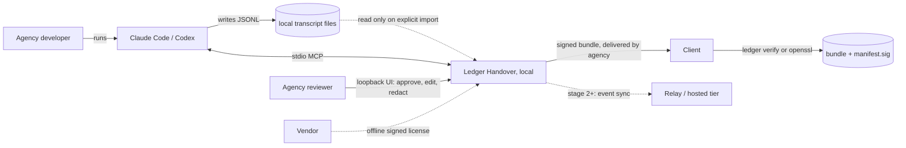
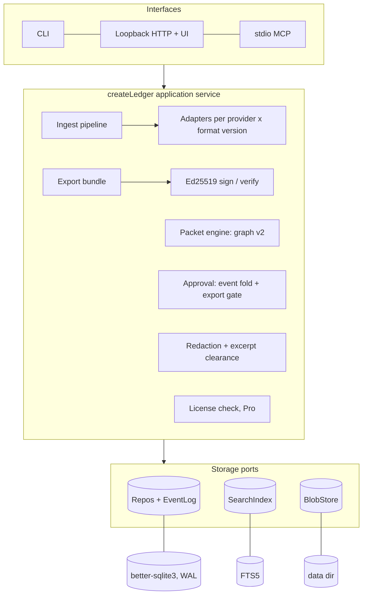

# Ledger Handover v1: target architecture

Status: proposed, 2026-11-06. Inputs: [product plan](strategy/product-plan.md), [engineering gaps](strategy/research-engineering-gaps.md), [handoff](handoff.md), [evals](evals.md).

Checked locally: Node 22.14.0's `node:sqlite` bundles SQLite 3.47.2 built without FTS3, FTS4, FTS5 or R-Tree. `CREATE VIRTUAL TABLE t USING fts5(x)` fails with `no such module: fts5`. That result decides ADR-003.

## 1. Constraints

- Transcripts are client IP and may hold credentials. v1 sends nothing over the network; only the agency-delivered export bundle leaves the machine.
- Every claim cites a stored message or repo artifact and is approved by a named human.
- Vendor formats are undocumented. Parsers detect the format version and fail closed on anything unknown.
- `npx` install on Windows, macOS and Linux with minimal, prebuilt dependencies.
- Team and hosted interfaces are fixed now; implementations come later.

## 2. System context



## 3. Components



**Ingest adapters.** An adapter is `{ provider, detect(headLines) -> formatVersion | null, parse(lineStream) -> AsyncIterable<Record> }`, registered by `(provider, formatVersion)`.
- Detection fingerprints the first records (Claude `version`/`uuid`, Codex `session_meta.payload.cli_version`). An unknown fingerprint raises `UnsupportedFormatError` and writes nothing.
- Parsing streams through `readline` with a 16 MiB line cap, so disk import skips the 8 MiB HTTP limit (gap 3).
- Today's `messageAt` and Codex filters become the `v1` adapters. Each format version gets a contract fixture.

**Incremental import.** `sources` stores `bytes_read` and the `prefix_sha256` of those bytes. On re-import, a matching prefix means only the tail is parsed. A mismatch means the file was rewritten, and the import fails with `TranscriptRewrittenError` instead of remapping IDs.

**Ledger core.** `createLedger({ dataDir, driver })` is the only code that touches storage. The CLI, HTTP and MCP call it in-process. The CLI no longer needs a server (gap 7), and the server becomes `createServer(ledger)` (gap 6).

**Packet engine.** Graph v2 is project-scoped. Node IDs are stable slugs. A citation is either `{ session, message, range? }` or `{ artifact }`. Validation runs cheapest first:
1. Ajv schema.
2. Referential: every citation resolves, and sidechain or compact-summary messages are never primary evidence.
3. Structural: the existing edge and cycle checks.
4. Derived: ready actions and current decisions.

Version ID = SHA-256 of canonical JSON (idempotent retries). Each node has a `node_sha256` over kind, label, status and citations.

**Approval workflow.** Review state is a fold over the append-only `events` table: `node.approved`, `node.edited`, `node.rejected`, `excerpt.cleared`, `packet.exported` and `key.rotated`.
- Approvals bind to a `node_sha256`. On re-publish, unchanged nodes keep approval and changed nodes reset.
- Export is allowed only when every node's latest decision approves its current hash, and every excerpt has a hash-matched `excerpt.cleared`.

**Redaction** works on cited excerpts, never on whole sessions.
- Detectors: regex for cloud keys, GitHub, Slack, Stripe and JWT tokens, PEM blocks, connection strings, emails, IPs and home paths, plus an entropy check (20 or more characters at 4.0 or more bits per character).
- The reviewer sees a diff, adjusts it and clears each excerpt.
- Any unresolved hit blocks export.

**Export bundle.** The builder accepts only cleared excerpts and approved nodes and has no handle on the message repository, so uncited text cannot reach the bundle. Output is a deterministic directory and stored-mode zip:
- `index.html`: no JavaScript, and a CSP meta tag of `default-src 'none'` with hashed styles.
- `packet.md` and `packet.json`
- `manifest.json`, `manifest.sig` and `VERIFY.txt`

**Signing.** `manifest.json` holds each file's SHA-256 and size, the packet and version IDs, the event-log head hash, the reviewers, the key ID and the time. It is serialized with RFC 8785 (JCS) and signed with raw Ed25519 from `node:crypto`, so signing adds no dependency.
- `ledger verify <bundle> --key <fingerprint>` checks the signature and every file hash. `VERIFY.txt` gives the OpenSSL 3 equivalent (`pkeyutl -verify -rawin`).
- The trust anchor is the key fingerprint, published out of band (in the SOW or `/.well-known/ledger-keys.json`).
- A signature proves authorship and integrity, not completeness.

**Interfaces.**
- **CLI:** everything, plus `serve`, `open` and `doctor`.
- **HTTP and UI:** browse and review.
- **stdio MCP:** `ledger_search`, `ledger_handoff` and `ledger_graph_read` are read-only. `ledger_import` ingests only paths the user names, and `ledger_graph_publish` writes drafts. No MCP tool can approve, clear, sign or export.

## 4. Data model

**Identity.**
- **Session:** `<provider>:<provider session UUID>`. From Claude `sessionId` or Codex `session_meta.payload.id`; fallback `h:` plus SHA-256 of the first non-empty line, which appends never change.
- **Message key:** `u:<record uuid>` where one exists (Claude). Otherwise (Codex `response_item`s) it is `h:` plus 32 hex characters of `sha256(sessionId \0 line \0 rawLineBytes)`. The line is part of the hash so identical "ok" turns stay distinct.
- **Duplicate UUIDs:** if the bytes are identical (a resumed session), the record is skipped. If the bytes differ, the import fails with `ConflictingRecordError`.
- **Citation ID:** `<sessionId>/<key>`. `messages.id` is only the FTS rowid and is never exported. File and line stay on every message, so v1 line citations still resolve.

```sql
-- migrations/0001_init.sql: one transaction, then PRAGMA user_version = 1
-- also: schema_migrations(version, name, sha256, applied_at); settings(key, value) for token hash, license, max_seen_time
CREATE TABLE projects (id TEXT PRIMARY KEY, slug TEXT NOT NULL UNIQUE, name TEXT NOT NULL,
  client TEXT, retention_days INTEGER, created_at TEXT NOT NULL) STRICT;
CREATE TABLE sources (id INTEGER PRIMARY KEY, project_id TEXT NOT NULL REFERENCES projects ON DELETE CASCADE,
  provider TEXT NOT NULL, format_version TEXT NOT NULL, file_name TEXT NOT NULL,
  bytes_read INTEGER NOT NULL, prefix_sha256 TEXT NOT NULL, imported_at TEXT NOT NULL) STRICT;
CREATE TABLE sessions (id TEXT PRIMARY KEY, project_id TEXT NOT NULL REFERENCES projects ON DELETE CASCADE,
  provider TEXT NOT NULL, provider_session_id TEXT NOT NULL, legacy_id TEXT UNIQUE, title TEXT NOT NULL,
  started_at TEXT, message_count INTEGER NOT NULL DEFAULT 0, UNIQUE (provider, provider_session_id)) STRICT;
CREATE TABLE messages (id INTEGER PRIMARY KEY, session_id TEXT NOT NULL REFERENCES sessions ON DELETE CASCADE,
  key TEXT NOT NULL, seq INTEGER NOT NULL, role TEXT NOT NULL CHECK (role IN ('user','assistant')),
  text TEXT NOT NULL, source_id INTEGER NOT NULL REFERENCES sources ON DELETE CASCADE,
  source_line INTEGER NOT NULL, record_sha256 TEXT NOT NULL, flags INTEGER NOT NULL DEFAULT 0, -- 1 sidechain, 2 compact
  ts TEXT, UNIQUE (session_id, key), UNIQUE (session_id, seq)) STRICT;
CREATE VIRTUAL TABLE messages_fts USING fts5(text, content='messages', content_rowid='id',
  tokenize='unicode61 remove_diacritics 2'); -- kept in sync by AFTER INSERT/DELETE triggers
INSERT INTO messages_fts(messages_fts, rank) VALUES ('secure-delete', 1);
CREATE TABLE artifacts (id TEXT PRIMARY KEY, project_id TEXT NOT NULL REFERENCES projects ON DELETE CASCADE,
  kind TEXT NOT NULL CHECK (kind IN ('commit','pr','file')), repo TEXT NOT NULL, ref TEXT NOT NULL,
  UNIQUE (project_id, kind, repo, ref)) STRICT;
CREATE TABLE actors (id TEXT PRIMARY KEY, kind TEXT NOT NULL CHECK (kind IN ('human','agent')),
  display_name TEXT NOT NULL, public_key TEXT) STRICT;
CREATE TABLE packets (id TEXT PRIMARY KEY, project_id TEXT NOT NULL REFERENCES projects ON DELETE CASCADE,
  title TEXT NOT NULL, created_at TEXT NOT NULL) STRICT;
CREATE TABLE packet_versions (id TEXT PRIMARY KEY, packet_id TEXT NOT NULL REFERENCES packets ON DELETE CASCADE,
  seq INTEGER NOT NULL, schema_version INTEGER NOT NULL, payload TEXT NOT NULL,
  published_by TEXT NOT NULL REFERENCES actors, created_at TEXT NOT NULL, UNIQUE (packet_id, seq)) STRICT;
CREATE TABLE nodes (version_id TEXT NOT NULL REFERENCES packet_versions ON DELETE CASCADE, node_id TEXT NOT NULL,
  kind TEXT NOT NULL, label TEXT NOT NULL, node_sha256 TEXT NOT NULL, PRIMARY KEY (version_id, node_id)) STRICT, WITHOUT ROWID;
CREATE TABLE citations (version_id TEXT NOT NULL, node_id TEXT NOT NULL,
  message_id INTEGER REFERENCES messages, artifact_id TEXT REFERENCES artifacts,
  char_start INTEGER, char_end INTEGER, is_primary INTEGER NOT NULL,
  FOREIGN KEY (version_id, node_id) REFERENCES nodes ON DELETE CASCADE,
  CHECK ((message_id IS NULL) <> (artifact_id IS NULL))) STRICT;
CREATE TABLE events (seq INTEGER PRIMARY KEY, id TEXT NOT NULL UNIQUE,
  packet_id TEXT NOT NULL REFERENCES packets ON DELETE CASCADE, actor_id TEXT NOT NULL REFERENCES actors,
  type TEXT NOT NULL, target TEXT, payload TEXT NOT NULL, prev_hash TEXT, hash TEXT NOT NULL, created_at TEXT NOT NULL) STRICT;
CREATE TABLE purge_guard (project_id TEXT PRIMARY KEY) STRICT; -- non-empty only inside a purge transaction
CREATE TRIGGER events_no_update BEFORE UPDATE ON events BEGIN SELECT RAISE(ABORT, 'append-only'); END;
CREATE TRIGGER events_no_delete BEFORE DELETE ON events WHEN NOT EXISTS (SELECT 1 FROM purge_guard)
  BEGIN SELECT RAISE(ABORT, 'append-only'); END;
CREATE TABLE signing_keys (id TEXT PRIMARY KEY, label TEXT NOT NULL, public_key_pem TEXT NOT NULL,
  private_key_pem_enc TEXT NOT NULL, created_at TEXT NOT NULL, revoked_at TEXT) STRICT;
CREATE TABLE exports (id TEXT PRIMARY KEY, packet_id TEXT NOT NULL REFERENCES packets ON DELETE CASCADE,
  version_id TEXT NOT NULL REFERENCES packet_versions, key_id TEXT NOT NULL REFERENCES signing_keys,
  bundle_sha256 TEXT NOT NULL, manifest TEXT NOT NULL, signature TEXT NOT NULL, created_at TEXT NOT NULL) STRICT;
```

**What the schema enforces:**
- `citations.message_id` has no cascade, so retention cannot remove a cited message.
- Events are immutable. Each one stores `hash = sha256(prev_hash ‖ JCS(event))`. This catches partial or accidental tampering, though not a determined owner of the file, and the signed manifest freezes the head hash.
- `provider` has no `CHECK` constraint. The adapter registry validates it, so a new provider doesn't need a table rebuild (gap 4).

**Migrations.**
- Forward-only numbered SQL files ship in the package. Each runs in one transaction, records its checksum and bumps `PRAGMA user_version`.
- `VACUUM INTO 'backups/ledger-v<N>.sqlite'` runs before migrating. Backups expire after 7 days or on purge.
- A database newer than the code fails with `SchemaTooNewError`. Constraint changes use SQLite's 12-step rebuild.
- `0002_import_v0` turns today's `sessions` and `graphs` into legacy sessions. `legacy_id` keeps the old `sha256(provider \0 file)` and keys become `l:<line>`, so v1 packets still validate. Re-importing the same bytes reproduces that hash and links the legacy session to its UUID session.
- Postgres migrations live in `migrations/pg/`. One repository contract suite runs against both databases.

## 5. Storage decision and interface

| Option | FTS5 | Install | Verdict |
|---|---|---|---|
| `node:sqlite` (Node 22.14) | No (checked) | Zero deps; experimental | Rejected for v1 |
| `better-sqlite3` | Compiled in | Prebuilt binaries for Node LTS on win-x64, darwin-x64/arm64, linux-x64/arm64 | **Chosen.** Stable synchronous API close to `DatabaseSync`; `better-sqlite3-multiple-ciphers` is the SQLCipher path |
| Our own inverted index on `node:sqlite` | Hand-rolled | Zero deps | Rejected: ~70M posting rows at 1.2M messages, far larger than FTS5 doclists |
| sql.js (wasm) | Yes | Zero native | Rejected: whole database in memory, no WAL |
| Require a newer Node whose SQLite has FTS5 | Not confirmed | Forces a Node upgrade | Revisit once `node:sqlite` is stable |

Search is a v1 feature, and without FTS5 it has no ranking, snippets or acceptable latency at the §7 target. The native-binary risk is contained three ways:
- `ledger doctor` names the platform on a load failure.
- The wave-5 clean-VM install eval on 3 OSes is the gate.
- A `node:sqlite` test driver stays in CI with `LIKE` search and a named "degraded search" warning, so the port is tested on two engines.

Open sets WAL, `busy_timeout = 5000`, `foreign_keys = ON` and `secure_delete = ON`; CLI and server share the file through short single-writer transactions.

**Storage port.** Every method is async, so a Postgres implementation needs no caller changes.

```ts
interface LedgerStorage { tx<T>(scope: { workspaceId: string }, fn: (r: Repos) => Promise<T>): Promise<T> } // 'local' in v1
interface Repos {
  projects; sources; sessions; messages; artifacts; packets; actors; keys; exports;
  search: SearchIndex; // query({ q, projectId, provider, before, after, limit }) -> hits with snippets
  events: EventLog;    // append(events, expectedHeadHash), since(cursor), head(packetId)
  blobs: BlobStore;    // put(bytes) -> sha256, get, delete
}
```

Locally, blobs are files in the data directory. The hosted implementation maps the repos to Postgres with row-level security on `workspace_id`, search to `tsvector` with a GIN index, and blobs to S3-compatible storage. Domain code never sees SQL.

## 6. Security and privacy

**Authentication.**
- First run writes a 256-bit token to `<dataDir>/auth-token` (0600) in the OS data directory (0700). Only `sha256(token)` is stored; comparison is timing-safe.
- Every `/api` route, GET included, requires the bearer token or session cookie, else 401.
- The token never reaches the browser. `ledger open` mints a single-use nonce valid for 60 seconds. `/auth/<nonce>` exchanges it for an `HttpOnly; SameSite=Strict` cookie.
- stdio MCP has no listener, and whoever can spawn it can already read the file, so it trusts the OS user.

**Browser boundary.** Today's protections stay: the Host allowlist (which blocks DNS rebinding), the exact Origin check on writes, JSON-only bodies, the streamed body cap, CSP, `nosniff`, `no-store`, no CORS, and binding to 127.0.0.1 only.

**Data at rest.** v1 relies on OS account isolation, the 0700 directory and full-disk encryption, which `ledger doctor` checks where the OS reports it. The signing key is passphrase-encrypted PKCS#8 (AES-256 via `node:crypto`). SQLCipher is deferred to Enterprise, because key recovery for a local tool costs more than it protects once full-disk encryption is on.

**Purge and retention.**
- Purge is one transaction: set `purge_guard`, delete the project (cascading to sessions, messages, FTS rows, packets, events), clear the guard. Then FTS5 `optimize`, `wal_checkpoint(TRUNCATE)`, `VACUUM`, and backup deletion.
- The eval scans raw `.sqlite`, `-wal` and `backups/` bytes for fixture text.
- Retention removes uncited messages older than `retention_days` (startup and hourly). "Evidence-only" mode keeps only cited messages after export.

| Threat | Control | Residual |
|---|---|---|
| Another local process reads the API | Token or cookie on every route; token file mode 0600 | Same-user malware reads the file directly |
| Website attacks 127.0.0.1 (CSRF, DNS rebinding) | Host allowlist, exact Origin, SameSite=Strict, JSON only, no CORS | Low |
| Prompt injection makes the agent draft false nodes | MCP cannot approve or sign; referential validation; human approves each node hash beside its evidence | Reviewer approves a wrong claim |
| XSS from transcript text | `textContent` only, strict CSP, no JS in the bundle, bidi and control escaping | Low |
| Secrets leak to the client | Allowlisted excerpts, detectors, per-excerpt sign-off, fail closed, a seeded 200-secret eval | Novel secret formats |
| Bundle altered after delivery | Ed25519 over a manifest of file hashes; verifiable with OpenSSL | None, if the fingerprint is pinned out of band |
| Signing key stolen | Passphrase encryption, `key.rotated` events, published revocation list | Bundles signed before revocation |
| Reviewer denies approving | Named actor, hash-chained events, head hash in the signed manifest | Identity is self-asserted until stage 2 |
| Format drift drops or leaks turns | Version detection, fail closed, fixture per version, 3-OS CI | Blocked until an adapter ships |
| Supply chain | Two runtime deps (`ajv`, `better-sqlite3`), lockfile, npm provenance | Medium |

## 7. Scaling path

**Capacity per agency per year.** Assumptions: 15 developers, 220 working days, 3 client sessions per developer per day, which gives about 10k sessions. Each session averages about 120 text messages of about 700 bytes (tool output excluded).

| Case | Volume | Text | FTS5 index | DB size per year |
|---|---|---|---|---|
| Import everything | 1.2M messages | ~0.85 GB | ~0.6 GB | ~1.8 GB |
| Realistic v1 (20 projects × 100 sessions) | 240k messages | — | — | ~0.35 GB |
| Review events (50 packets × 100 nodes × 6) | ~30k events | — | — | negligible |

**Targets** (laptop SSD, 1.5M-message ceiling, ~3 GB): FTS5 bm25 search with 50 snippets p95 < 50 ms (< 150 ms filtered); import ≥ 20 MB/s; validating 100 nodes and 1,000 citations < 100 ms; 1,000-excerpt export < 2 s.

| | Stage 1: local (v1) | Stage 2: team, self-hosted relay | Stage 3: hosted SaaS and enterprise self-host |
|---|---|---|---|
| Ingest | Local, explicit | Local on each machine | Still local. The cloud never pulls transcripts |
| Store | better-sqlite3 + FTS5 | Local store plus a relay (small Node service, SQLite or Postgres) | Postgres with RLS and hash-partitioned events, S3 blobs, Postgres FTS; OpenSearch only past ~100M messages |
| Sync | None | Push/pull events since a cursor: packets, events and cleared excerpts; transcripts opt-in. Optional E2E encryption to a project X25519 key | The same protocol, multi-tenant |
| Identity | Self-asserted name | Per-reviewer Ed25519 keys sign their events; approval policies such as "2 approvals, one lead" | OIDC SSO and SCIM, roles, audit export |
| Signing | Local key with passphrase | Lead's key, or per-reviewer co-signatures | KMS/HSM where Ed25519 is available, otherwise a local signer |
| Ops | npx | Docker image for the relay | Region pinning; self-host on the same images suits data-residency rules such as Uzbekistan's personal-data localization law |

**Merging without a CRDT library.** Messages and packet versions are immutable and content-addressed, so their union is conflict-free. Review decisions are events with a ULID, device ID and hybrid logical clock. Every replica folds the same events in `(hlc, id)` order and reaches the same state. Concurrent edits to one node are never auto-merged: the node becomes `conflicted` until a human resolves it. Yjs or Automerge would merge silently and break "a named human approved exactly this".

**Stays the same at every stage:** the graph v2 contract, event types and fold, adapters, manifest format, `ledger verify`, the MCP tools and the storage port. **Changes:** the storage implementation, identity, key custody and the sync layer.

## 8. Open-core boundary

| Apache-2.0 core | Commercial Pro (source-available) |
|---|---|
| Adapters, import, incremental import, FTS search | Reviewer UI and export gate |
| Projects, delete, retention, token auth | Redaction detectors, diff and excerpt clearance |
| stdio MCP server, drafting skill | Signed HTML and Markdown bundle builder |
| Graph v2 schema, validator, Markdown handoff | White-label branding |
| `ledger verify` and the open manifest and bundle spec | Stage 2+: relay, multi-reviewer policies, SSO |

Verification stays free, so a client never needs a license to check a packet. Agencies pay for the workflow that produces it.

**Offline licenses.**
- A license is a JCS JSON document `{ licenseId, customer, plan, maxReviewers, features, issuedAt, expiresAt, graceDays: 30 }` signed with the vendor's Ed25519 key. The public key is embedded in Pro, and there is no phone-home.
- For a per-packet purchase, checkout receives only the random packet ULID. The returned token is bound to that ID, so it cannot be reused for another packet.
- If the license expires or is missing, everything stays readable and only signed export is blocked.
- A monotonic `max_seen_time` blunts clock rollback.
- A fork can strip the checks. The license serves honest agencies, not DRM. Stripe payment links trigger a vendor webhook that emails keys.

## 9. ADRs

Each is accepted. Rejected alternatives in brackets.

1. Local-first, no egress in v1 [cloud ingest, day-one sync].
2. One in-process `createLedger` core behind CLI, HTTP and MCP [CLI as HTTP client, MCP daemon].
3. better-sqlite3 with FTS5, §5 [`node:sqlite`, custom index, wasm].
4. Session is `provider:uuid`; message key is the record UUID or a line-and-bytes hash [whole-file hash breaks on append; line-only misses rewrites].
5. Forward-only migrations with backups; refuse newer schemas [`IF NOT EXISTS` drift, untested down-migrations].
6. Append-only, hash-chained review events; state is a fold [mutable status columns].
7. Content-addressed versions; approval bound to node hash [per-version approval forces full re-review].
8. Allowlist export from cleared excerpts [blocklist redaction].
9. Raw Ed25519 over a JCS manifest, fingerprint out of band [PGP for UX; Sigstore, whose public log exposes client relationships; PAdES for CA cost].
10. Loopback token exchanged for a cookie; stdio trusts the OS user [token in the URL fragment].
11. Fail closed on unknown formats [best-effort parsing].
12. Team sync by event-log replication [CRDT libraries merge silently; a central database means cloud custody].
13. Apache-2.0 core plus Pro; offline signed licenses and packet-bound tokens [AGPL, online activation].
14. Hosted tier on Postgres and object storage behind the same port, ingest stays local [SQLite per tenant].

## 10. Wave mapping

Wave 1: ADRs 2–6 and 11, migrations 0001–0002, token auth, purge. Wave 2: graph v2 (ADR 7), MCP, artifact anchors. Wave 3: event fold and reviewer UI. Wave 4: ADRs 8–9. Wave 5: driver install gate and licensing (ADR 13). Stages 2–3 start only after product-plan gate G2.
